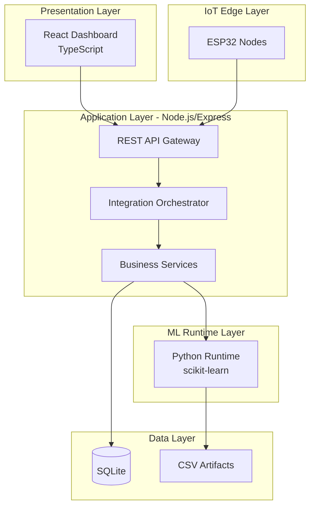
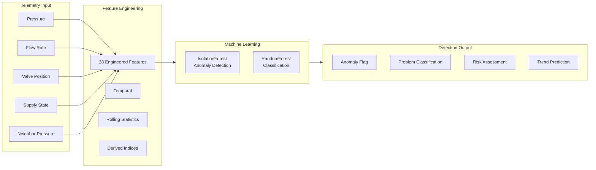
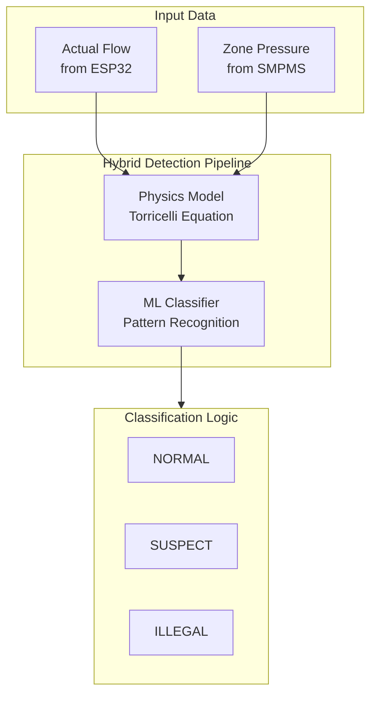
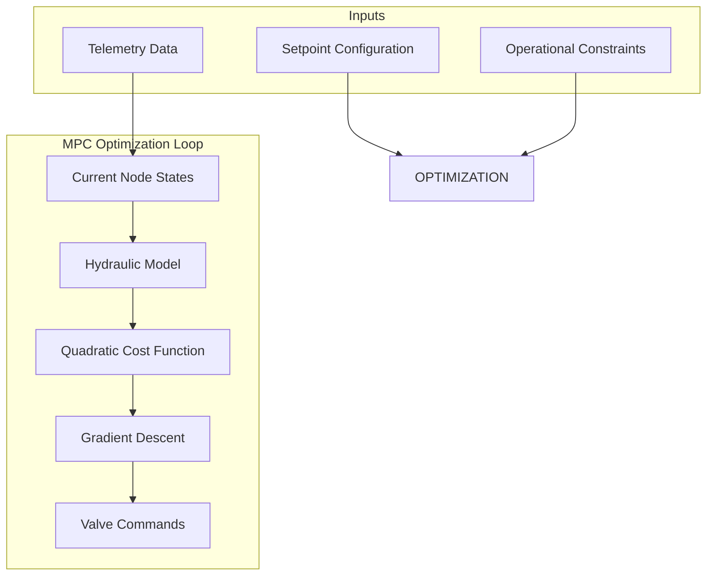
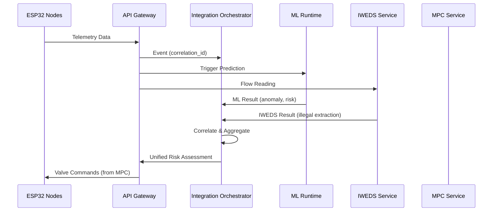
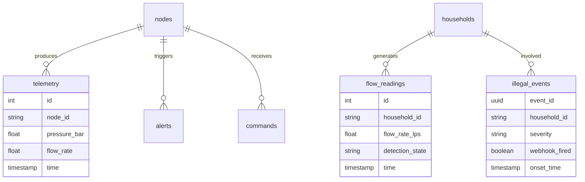
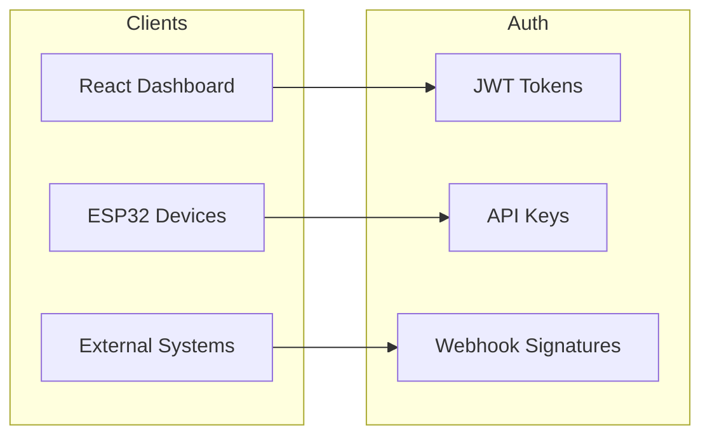
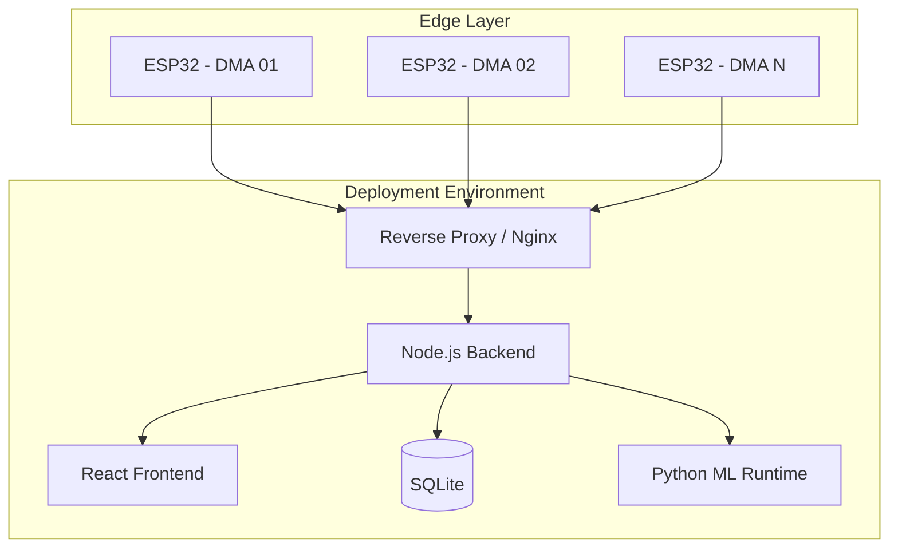

# Software Methodology Overview Report
## SMPMS — Smart Pressure Management System

---

## 1. Executive Summary

The Smart Pressure Management System (SMPMS) represents a comprehensive SCADA-style IoT platform engineered for municipal water distribution network monitoring and control. This report provides a detailed exposition of the software development methodology, architectural paradigms, and technological foundations that underpin the system. The methodology embraces a multi-layered approach integrating classical physics-based detection, advanced machine learning techniques, and model predictive control to deliver a robust, scalable, and intelligent water network management solution.

The system comprises three principal functional modules, each employing sophisticated algorithmic approaches: **Leakage Detection** leveraging machine learning for anomaly identification, **Illegal Water Extraction Detection System (IWEDS)** utilizing physics-based flow analysis, and **Model Predictive Control (MPC)** for optimized pressure regulation. Importantly, all three modules incorporate machine learning capabilities rather than relying solely on deterministic algorithms, reflecting a commitment to data-driven intelligence throughout the architecture.

---

## 2. System Architecture Overview

### 2.1 High-Level Architectural Paradigm

The SMPMS adopts a **layered service-oriented architecture** with clear separation of concerns across presentation, business logic, data persistence, and physical device interaction layers. The architecture implements an **event-driven integration pattern** enabling loose coupling between modules while maintaining data consistency and correlation capabilities.



### 2.2 Module Composition

| Module | Primary Function | ML Utilization | Control Paradigm |
|--------|------------------|----------------|------------------|
| **Leakage Detection** | Anomaly identification & root cause classification | IsolationForest (anomaly), RandomForest (classification) | Advisory |
| **IWEDS** | Illegal water extraction identification | Classification models for pattern recognition | Reactive |
| **Pressure Regulation** | Network-wide valve optimization | Predictive optimization models | Automatic (MPC) |

---

## 3. Technology Stack

### 3.1 Backend Technologies

The backend is constructed on a **Node.js runtime** with **Express.js** framework, implemented in **TypeScript** for type safety and maintainability. This choice provides non-blocking I/O characteristics essential for handling concurrent IoT device connections while maintaining strong compile-time error detection.

| Component | Technology | Rationale |
|-----------|------------|-----------|
| Runtime | Node.js 18+ | Asynchronous I/O for IoT data ingestion |
| Framework | Express.js | Lightweight HTTP handling |
| Language | TypeScript | Type safety, IDE support |
| Database | SQLite | Zero-configuration, embedded, ACID-compliant |
| ML Runtime | Python 3.x | Scikit-learn ecosystem |
| Authentication | JWT | Stateless, scalable session management |

### 3.2 Frontend Technologies

The frontend employs **React** with **TypeScript**, utilizing **Zustand** for state management. This combination provides reactive UI updates with predictable state transitions essential for real-time monitoring dashboards.

| Component | Technology | Purpose |
|-----------|------------|---------|
| Framework | React 18 | Component-based UI architecture |
| Language | TypeScript | Type-safe component development |
| State | Zustand | Lightweight, hook-based state management |
| Build | Vite | Rapid development experience |

### 3.3 Edge Computing

**ESP32 microcontrollers** serve as edge computing nodes, executing firmware that handles sensor data acquisition, local decision-making, and network communication. The firmware is developed using the Arduino framework, providing hardware abstraction and library support.

---

## 4. Leakage Detection Module — Methodology

### 4.1 Architectural Philosophy

The Leakage Detection module implements a **supervised machine learning pipeline** that transforms raw telemetry into actionable intelligence. The module operates on the principle that anomalous patterns in pressure, flow, and valve dynamics indicate underlying network issues including leaks, bursts, sensor faults, and infrastructure degradation.

### 4.2 Machine Learning Approach

The module employs an **ensemble methodology** combining unsupervised anomaly detection with supervised classification:



### 4.3 Feature Engineering

The module constructs **28 engineered features** from raw telemetry, organized into four categories:

- **Raw Telemetry**: pressure, flow_rate, valve_position, supply_on, control_action, neighbor_pressure
- **Temporal Features**: delta_pressure, delta_flow, pressure_gradient, pressure_gradient_abs
- **Rolling Statistics**: pressure_roll_mean_5, pressure_roll_std_5, flow_roll_mean_5
- **Derived Indices**: flow_pressure_ratio, burst_stress_index, vibration_acoustic_index
- **Binary Flags**: is_night, unexplained_pressure_drop, construction_flag

This feature engineering approach enables the ML models to capture both instantaneous state and temporal dynamics essential for distinguishing between normal operational variations and genuine anomalies.

### 4.4 Model Architecture

The detection pipeline utilizes two complementary models:

| Model | Purpose | Configuration |
|-------|---------|---------------|
| **IsolationForest** | Anomaly Detection | 300 estimators, 8% contamination threshold |
| **RandomForestClassifier** | Event Classification | 300 estimators, balanced class weights |

The anomaly threshold is calibrated at the **95th percentile** of anomaly scores, ensuring that the top 5% most anomalous conditions receive flagging. This threshold-based approach balances sensitivity with specificity, reducing false positive rates while maintaining detection capability.

### 4.5 Execution Paradigm

The ML pipeline supports dual execution modes:

- **Scheduled Execution**: Automatic execution every 5 minutes (configurable), enabling continuous monitoring
- **On-Demand Execution**: Manual trigger via API for immediate analysis

This dual-mode approach ensures both continuous surveillance and targeted investigation capabilities.

---

## 5. IWEDS Module — Methodology

### 5.1 Detection Philosophy

The Illegal Water Extraction Detection System (IWEDS) implements a **physics-based detection methodology** augmented with machine learning classification. The core principle derives from the observation that legitimate household water draw is constrained by gravitational pressure at the supply point; any significant excess indicates the presence of a booster motor—an illegal extraction device.

### 5.2 Physics-Based Foundation

The detection algorithm applies the **Torricelli orifice model** to compute theoretical passive flow:

```
Q_theoretical = Cd × A × √(2 × P / ρ)
```

| Parameter | Description | Typical Value |
|-----------|-------------|---------------|
| Cd | Discharge coefficient | 0.62 |
| A | Pipe cross-sectional area | Computed from diameter |
| P | Supply pressure (Pa) | From zone sensors |
| ρ | Water density | 1000 kg/m³ |

### 5.3 Machine Learning Integration

While the core detection relies on physics-based calculation, IWEDS incorporates machine learning for advanced classification:



The ML component provides pattern recognition capabilities for:
- Distinguishing between transient anomalies and persistent extraction
- Classifying extraction severity levels
- Identifying temporal patterns indicative of systematic theft

### 5.4 State Machine

| State | Condition | Action |
|-------|-----------|--------|
| **NORMAL** | Q_excess ≤ 0 | Log, no alert |
| **SUSPECT** | 0 < Q_excess ≤ WARN_THRESHOLD | Log, monitor |
| **ILLEGAL** | Q_excess > ALERT_THRESHOLD | Trigger webhook |

### 5.5 Confirmation Mechanism

To prevent false positives from transient conditions (e.g., valve adjustments), IWEDS implements a **120-second confirmation window** requiring persistent excess flow before triggering alerts. Additionally, a **600-second cooldown** between repeated alerts prevents notification storms.

---

## 6. Pressure Regulation Module — Methodology

### 6.1 Control Philosophy

The Pressure Regulation module implements **Model Predictive Control (MPC)**—an advanced control strategy that optimizes valve positions across the entire network simultaneously. Unlike traditional rule-based control that operates on individual nodes in isolation, MPC accounts for the hydraulic interdependencies between DMA zones.

### 6.2 MPC Architecture



### 6.3 Mathematical Foundation

The optimizer minimizes a **quadratic cost function**:

```
Cost = α × Σ(P_i - setpoint_i)² + β × Σ(ΔV_i)²
```

Subject to constraints:
- V_i ∈ [valve_min, valve_max]
- |ΔV_i| ≤ max_valve_step
- P_i ≥ min_pressure_bar

The **hydraulic model** (linear approximation):

```
P_i = P_source - k_elevation × elevation - k_resistance × (1 - V_i/100) × flow
```

### 6.4 Machine Learning Integration

While the core MPC utilizes mathematical optimization, the system incorporates ML for:

- **Demand Forecasting**: Predicting future consumption patterns to anticipate pressure requirements
- **Anomaly Pre-filtering**: Using leakage detection outputs to inform optimization priorities
- **Adaptive Calibration**: Learning model parameters from historical data

### 6.5 Control Mode

The module operates in **automatic mode** with the following characteristics:

- **Cycle Interval**: 30 seconds (configurable)
- **Rate Limiting**: Maximum 10% valve change per cycle
- **Fallback**: Rule-based control when MPC is disabled

---

## 7. Integration Architecture

### 7.1 Event-Driven Orchestration

The system implements an **Integration Orchestrator** that correlates events across all three modules, providing unified analytics and risk assessment:



### 7.2 Cross-Module Risk Normalization

The orchestrator implements a **risk normalization layer** that maps diverse module-specific states to a common vocabulary:

| Module | State Values | Normalized State |
|--------|--------------|------------------|
| IWEDS | NORMAL, SUSPECT, ILLEGAL | integration_risk_state |
| Leak ML | anomaly + predicted event | integration_risk_state |
| MPC | NORMAL, LOW, WARNING, CRITICAL | integration_risk_state |

### 7.3 Unified APIs

The integration layer exposes cross-module analytics endpoints:

| Endpoint | Purpose |
|----------|---------|
| `/api/v1/integration/zones/:zoneId/risk` | Unified risk + contributors |
| `/api/v1/integration/zones/:zoneId/timeline` | Correlated events across modules |
| `/api/v1/integration/summary` | System-wide KPIs |

---

## 8. Data Architecture

### 8.1 Persistence Strategy

The system employs a **polyglot persistence** approach:

| Data Type | Storage | Rationale |
|-----------|---------|-----------|
| Telemetry | SQLite | ACID compliance, embedded |
| ML Artifacts | CSV/Joblib | Format compatibility with Python |
| Configuration | Environment/JSON | Runtime flexibility |
| Reference Data | SQLite | Joins, queries |

### 8.2 Schema Organization



---

## 9. Development Methodology

### 9.1 Code Organization

The codebase follows a **modular monolith** pattern within the backend:

```
backend/src/
├── modules/
│   ├── esp/          # ESP32 communication
│   ├── telemetry/    # Data ingestion
│   ├── mpc/          # Pressure control
│   ├── iweds/        # Extraction detection
│   ├── dashboard/    # UI data aggregation
│   └── integration/  # Cross-module orchestration
├── core/             # Shared utilities
├── repositories/     # Data access
└── middleware/       # Cross-cutting concerns
```

### 9.2 API Design Principles

The API follows **RESTful conventions** with:
- Resource-based URL structure
- Standard HTTP methods (GET, POST, PUT, DELETE)
- JSON request/response format
- Proper HTTP status codes

### 9.3 Testing Strategy

| Test Type | Coverage | Framework |
|-----------|----------|-----------|
| Unit | Individual functions | Jest |
| Integration | API endpoints | Supertest |
| Module | Cross-component | Custom |

---

## 10. Security Architecture

### 10.1 Authentication Layers



### 10.2 Security Measures

| Layer | Implementation |
|-------|----------------|
| Authentication | JWT (dashboard), API Key (ESP32) |
| Authorization | Role-based access control |
| Transport | HTTPS enforcement |
| Input Validation | Schema validation, sanitization |
| Rate Limiting | Endpoint-specific throttling |

---

## 11. Deployment Architecture

### 11.1 Component Distribution



### 11.2 Scalability Characteristics

| Component | Scaling Strategy |
|-----------|------------------|
| Backend | Horizontal (stateless) |
| Frontend | CDN, caching |
| Database | Read replicas (future) |
| ML Runtime | Parallel processing |
| ESP32 Nodes | Network partitioning |

---

## 12. Operational Excellence

### 12.1 Monitoring & Observability

The system implements comprehensive logging with **correlation IDs** enabling end-to-end tracing across modules:

```json
{
  "correlation_id": "uuid",
  "source_module": "ml",
  "node_id": "DMA-01",
  "risk_level": "HIGH",
  "timestamp": "2026-04-11T12:00:00Z"
}
```

### 12.2 Alerting

- **Telegram Integration**: Real-time notifications for critical events
- **Threshold-based Triggers**: Configurable alert thresholds
- **Event Correlation**: Multi-source event correlation for reduced false positives

---

## 13. Conclusion

The SMPMS methodology represents a sophisticated integration of classical engineering principles with contemporary machine learning techniques. The architecture demonstrates a commitment to:

1. **Modularity**: Clear separation enabling independent evolution of components
2. **Intelligence**: ML augmentation across all three core modules
3. **Scalability**: Design patterns supporting network growth
4. **Reliability**: Event-driven orchestration with correlation and confirmation mechanisms
5. **Maintainability**: TypeScript implementation, comprehensive documentation

The system's multi-layered approach—combining physics-based detection (IWEDS), anomaly-based machine learning (Leakage Detection), and predictive optimization (MPC)—provides a robust foundation for intelligent municipal water network management. The event-driven integration architecture ensures that these capabilities operate in concert, delivering unified situational awareness and automated response capabilities.

---

*Report generated: April 2026*
*System Version: v1.0*
*Architecture: Event-Driven Service-Oriented with ML Integration*